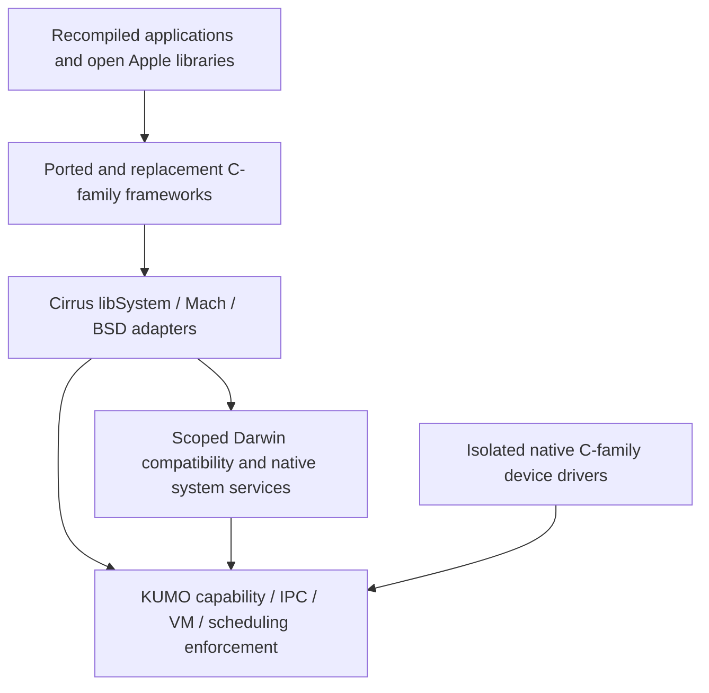

# Darwin ecosystem on KUMO

Status: architectural direction. The compatibility services and replacement
frameworks described here are not implemented. The current executable proof
is the C/C++ runtime and C loader booting on the vendored KUMO kernel.

## Objective

Rebuild the open Darwin/iOS-style system stack on KUMO/MUREX, preserving useful
developer interfaces and upstream code while implementing the missing platform
and closed-source layers in C, C++, Objective-C and Objective-C++.

KUMO remains the microkernel and the enforcement authority for capabilities,
address spaces, scheduling and device access. Cirrus supplies the Darwin
personality, system services, SDK and mobile frameworks. Kernel implementation
changes remain in the upstream Rust kernel closure; new Cirrus system code is
C-family. CMake remains the outer build system, integrating upstream build
systems where needed.

This direction prioritizes reuse of the open Apple stack. Alternative runtimes
such as mlibc remain evaluation candidates, not an automatic replacement for
the planned Libc/libSystem port. Changes to that strategy require an explicit
architecture decision.

## Compatibility levels

| Level | Target | Evidence required |
| --- | --- | --- |
| 0: native platform | C/C++ programs using the KUMO ABI | Existing EL0 trap, channel and shared-VMO smoke tests |
| 1: source ports | Recompiled Apple/BSD libraries and utilities using a Cirrus SDK | A named upstream revision builds and runs with tested platform adapters |
| 2: framework APIs | Published C/Objective-C APIs implemented by ported or replacement libraries | A versioned API profile and executable behavioral tests, including lifecycle and errors |
| 3: native Mach-O | Programs and dynamic libraries built for a defined Cirrus Mach-O SDK | Loader, dyld, relocations, TLS, initialization, unwind/runtime ABI and shared-library tests |
| 4: selected external binaries | Specific independently built Darwin executables | An explicit architecture/OS/dependency profile and per-program qualification |

The initial goal is level 1, with level 2 developed in bounded increments.
Levels 3 and 4 are separate milestones. A successful source port does not
establish external binary compatibility. The initial bootstrap remains static
ELF; supporting Mach-O user programs does not require changing the kernel's
own ELF boot format.

An API profile must name its upstream baselines, architectures, supported
symbols, structures, behavior and known exclusions. Symbol presence alone is
insufficient. Begin with ARM64 LP64; additional ABIs, including arm64e, need
their own decisions. Do not combine GNUstep and Apple Objective-C runtime ABIs
in one SDK without an explicitly implemented and tested interoperability plan.

## Architecture

Initially, rebuilt libraries call Cirrus adapters that use the native KUMO ABI.
No foreign syscall routing is required for this source-port stage. Pure local
operations stay in the library; operations requiring shared state use scoped
services. Kernel fast paths are introduced only where semantics or measured
performance justify them.

A later binary-ABI profile may require loader-selected process metadata and
Mach/BSD trap dispatch or userspace upcalls. Such a profile changes the
interface presented to a process. It does not relax the process's native KUMO
authority. A process cannot grant itself privileges by selecting a personality.

Darling is a useful implementation reference: its libsystem_kernel adapters
and userspace server reproduce services normally provided by XNU. Its Linux
backend cannot be imported as a KUMO backend without a port. Selected XNU/Darling
implementation reuse must keep upstream provenance and backend boundaries
visible. No full XNU kernel or Linux driver runtime is enabled by this decision.

## Reuse and replacement projects

The paths below are proposed ownership boundaries, not existing implementations.
Keep upstream snapshots under `third_party/` and Cirrus adapters outside them.
Each project should become a build target only when it has substantive code
and a runnable acceptance test.

| Project / proposed path | Reuse | Cirrus responsibility | First acceptance proof |
| --- | --- | --- | --- |
| Darwin platform, `userland/darwin/` | Pinned Libc, Libsystem, XNU public interfaces and selected BSD sources | Startup, memory allocation, errno/TLS, platform calls and a coherent sysroot | Existing C utility performs allocation and file I/O on KUMO |
| Threading and events, `userland/darwin/` | Applicable pthread, Blocks and libdispatch sources | Thread lifecycle, locks, waits, time, cancellation and event/workqueue backend | Cross-thread wake, timeout, teardown and dispatch tests on KUMO |
| Mach services, `services/mach/` | Mach/MIG contracts and evaluated XNU/Darling implementation pieces | Task-local port namespaces, right transfer/lifetime, notifications and VM/task interfaces | Two isolated processes exchange a right; unauthorized access and stale names fail |
| Process and service bootstrap, `services/bootstrap/` | Pinned launchd sources and its service model | Scoped discovery, executable loading, capability grants, supervision and reconnection | Failed service restarts without granting new authority to its clients |
| Executable loading, `userland/loader/` | Pinned dyld, cctools and LLVM facilities | Defined Mach-O/startup ABI, image mapping, relocation, symbol binding and SDK tools | Cirrus-built Mach-O program loads a shared library and runs its constructors |
| Foundation layer, `frameworks/foundation/` | Pinned CF; evaluated objc4 or libobjc2 and GNUstep Base | Chosen runtime ABI, missing API behavior and platform backends | Objective-C program uses collections, lifetime management and a working run loop |
| Mobile UI and composition, `frameworks/ui/`, `services/compositor/` | Evaluate existing C-family rendering libraries and Mesa backends | View/lifecycle APIs, events, scene composition, text/accessibility integration and display/input services | Two isolated applications render separate surfaces; focus and background transitions work |
| Media and device frameworks, `frameworks/media/`, `services/` | Evaluated open media libraries and available hardware code | Audio/video/camera API profiles, buffers, timing, permissions and isolated device services | Authorized stream works; unauthorized client cannot obtain a device or another client's buffers |
| Application security and lifecycle, `services/security/`, `services/apps/` | Evaluated cryptographic and signing libraries | Package identity, entitlements, key storage, permission mediation, install/update and lifecycle policy | Tampered package is rejected; permission denial holds across restart and relaunch |
| Mobile hardware, `drivers/` | Applicable documented upstream C drivers and device references | Clock/power/interrupt/DMA integration, storage, display, touch and communications | A named device driver survives fault/reset while unrelated services remain operational |

UI, media, security and lifecycle rows describe original Cirrus projects for
the missing layers. They are not imports of proprietary UIKit, CoreAnimation,
Metal, AVFoundation, Security or other Apple implementations. Any analogous
API profile must be defined and tested separately; implementation names must
not imply coverage that has not been achieved.

Frameworks do not own arbitrary hardware authority. Applications receive
scoped service interfaces; drivers receive the relevant native device
capabilities. A framework API cannot bypass this separation.

## Security contract

1. **One enforcement model.** Native and Darwin-personality processes remain
   subject to KUMO's access checks. Compatibility operations use existing
   capabilities or explicit authorized delegation, never authority inferred
   solely from a filename, PID, UID or Mach port number.
2. **Scoped brokers.** A compatibility server with broad task/file/device
   authority is part of the trusted computing base. Split state by protection
   domain and grant each broker only the authority its service needs. Kernel
   checking does not by itself prevent a privileged broker becoming a confused
   deputy.
3. **Trusted identity.** Bind authorization to trusted channel/session
   provenance or kernel-authenticated credentials. A client-authored audit
   token or PID is not authentication. Define what happens when a session
   capability is delegated before claiming sender-identity compatibility.
4. **Faithful rights.** Distinguish send, receive and send-once semantics,
   transfer dispositions, reference counts, port sets and death notifications.
   KUMO `Port` is a signal-wait object, not an implementation of a Mach port.
   Generic `DUPLICATE`/`TRANSFER` bits are not by themselves a full Mach model.
5. **Explicit privileged operations.** Task control, debugging, exceptions,
   cross-process memory and device interfaces require appropriate authority.
   Deny or document unsupported behavior rather than reporting fake success.
6. **Correct teardown.** Specify outstanding calls, transferred rights,
   mappings, DMA quiescence and stale service names after crash/restart. Do
   not assume closing one handle revokes all already-delegated copies.
7. **Bounded resource use.** Account for queued messages, rights, shared
   memory, threads and CPU budgets. Test exhaustion and recovery alongside
   successful calls.

The kernel backlog is driven by real contracts. For example, the current C
ABI lists `VmarProtect` and `ChannelCall` as reserved/unimplemented. Full Mach
VM protection or atomic call behavior cannot be claimed from those declarations.
Audit exception delivery, authenticated credentials, copy-on-write, thread
control and atomic right-transfer requirements against the live kernel before
choosing where each behavior belongs. Userspace implementations are acceptable
when they preserve the required security, semantics and performance.

## Milestones and gates

| Gate | Deliverable | Exit criteria |
| --- | --- | --- |
| D0: dependency profile | Audit the pinned Libc/libSystem, CF, libdispatch, launchd and dyld dependencies; select a minimal source-port profile | Per-component API/kernel requirement list, chosen initial runtime ABI and executable test specifications |
| D1: C platform | Implement the required native wrappers, allocation, TLS/thread and file/process service substrate | A real upstream C program runs on KUMO; tests include denial, lifetime and error behavior |
| D2: Mach service subset | Implement only the Mach contracts needed by the chosen source ports | Multiprocess IPC/right-transfer proof, trusted identity, timeouts, cancellation, stale-name rejection and quota tests |
| D3: open framework proof | Port the selected Objective-C runtime, Foundation/CF subset, Blocks and dispatch backend | Objective-C application executes on KUMO with run-loop events, a dispatch job and correct teardown |
| D4: mobile vertical slice | Original application lifecycle, compositor/input service and minimal UI framework | Two isolated applications render and receive input; service failure does not expose the other application's state |
| D5: Mach-O profile | Add the defined loader/SDK/dyld path when earlier services support its requirements | Dynamic executable/library, initialization, TLS, unwind and permission tests pass |

D0 is the next implementation-planning gate. This document alone does not
complete its dependency audit. D1/D2 may develop together for particular
libraries; D4 device work can proceed alongside runtime work. None of these
gates is completed by merely adding source snapshots or declaration stubs.

Security acceptance includes adversarial clients and malformed IPC. Performance
acceptance records throughput, tail latency, memory and, on hardware, energy
for representative operations. Resilience acceptance includes service crashes,
restart loops, interrupted writes and failed/unconfirmed update boots. Results
must distinguish QEMU from actual phone hardware.

## Sources and current scope

- [Pinned source inventory](../third_party/manifest.tsv).
- [Apple Mach model](https://developer.apple.com/library/archive/documentation/Darwin/Conceptual/KernelProgramming/Mach/Mach.html).
- [Darling server architecture](https://github.com/darlinghq/darling-docs/blob/master/src/internals/darlingserver/README.md).
- [Darling syscall adapters](https://docs.darlinghq.org/internals/basics/system-call-emulation.html).
- [dyld startup and Mach-O design](https://github.com/apple-oss-distributions/dyld/blob/main/doc/dyld4.md).
- [libobjc2 runtime ABIs](https://github.com/gnustep/libobjc2).
- [GNUstep Base at the pinned revision](https://github.com/gnustep/libs-base/tree/818b4b8ddd1b97dd7269136425cbd63da9e73622).
- [Portable libdispatch implementation](https://github.com/swiftlang/swift-corelibs-libdispatch).

Current license metadata distinguishes GNUstep library code (LGPL) from its
GPL tools/tests. Source selection and any per-file exceptions remain tied to
the pinned upstream notices. No new upstream implementation is imported or
linked by this architecture decision.

Closed application frameworks, proprietary services, distribution channels and
device firmware are separate from the open source inventory. Replacements
must establish their own functionality and interoperability. The project does
not currently promise arbitrary stock iOS applications, Apple service access
or complete iOS SDK coverage. Optional application languages and Android guest
work do not become dependencies of the C-family native foundation.
